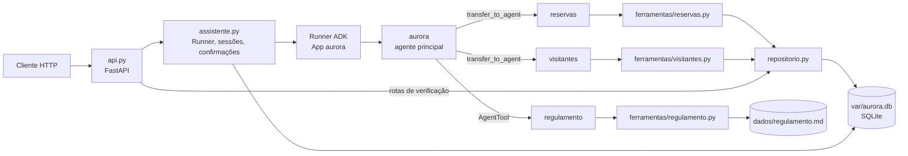

# 🚀 Desafio MBA Engenharia de Software com IA - Full Cycle


# Residencial Aurora: assistente virtual com Google ADK

Assistente do app dos moradores, exposto por uma API em `http://localhost:8000`. Pelo chat, o morador reserva e cancela áreas comuns, autoriza visitantes e tira dúvidas sobre o regulamento.

> **O modelo decide o caminho, o código decide o que é permitido.** As regras críticas vivem nas tools, no banco e na API, não no prompt.

Stack: Python 3.12 + uv, `google-adk==2.2.0`, Gemini (`gemini-2.5-flash`) via Google AI Studio, FastAPI + Pydantic e SQLite (`aiosqlite`).

---

## Arquitetura



### Agentes ([`src/aurora/agentes.py`](src/aurora/agentes.py))

| Agente | Responsabilidade | Acionamento | Por quê |
|---|---|---|---|
| `aurora` (principal) | Identifica o assunto e distribui o trabalho. | Raiz do `App`. | Ponto de entrada único. Não tem tools de dados nem o regulamento: mesmo manipulado, não grava nada. |
| `reservas` | Disponibilidade, listar, criar e cancelar reservas do apartamento da sessão. | `sub_agent` (`transfer_to_agent`). | Pede confirmação de cobrança. Como `sub_agent` transferível, é o autor do pedido, e o Runner retoma nele (Garantia 1). |
| `visitantes` | Listar e autorizar visitantes do apartamento da sessão. | `sub_agent` (`transfer_to_agent`). | Pelo mesmo motivo: autorizar visitante sempre pede confirmação. |
| `regulamento` | Responde dúvidas lendo **um capítulo** do regulamento. | `AgentTool` do principal. | Roda num Runner próprio, com `InMemorySessionService`: o capítulo fica isolado, e só a resposta final entra na sessão (Garantia 4). |

Todos usam um único `Gemini` com `retry_options` (espera exponencial no `429`).

### Camadas e persistência

| Arquivo | Papel |
|---|---|
| [`src/aurora/api.py`](src/aurora/api.py), [`esquemas.py`](src/aurora/esquemas.py) | Rotas do contrato, modelos Pydantic e erros (`404`, `409`, `503`). |
| [`src/aurora/assistente.py`](src/aurora/assistente.py) | Sessões, execução do `Runner`, `confirmacoes_pendentes` e a resposta de confirmação no formato do ADK. |
| [`src/aurora/ferramentas/`](src/aurora/ferramentas) | Tools dos especialistas: a única porta do modelo para os dados. |
| [`src/aurora/repositorio.py`](src/aurora/repositorio.py) | SQL de reservas, visitantes e sessões, sempre filtrado pelo apartamento de quem chama. |
| [`src/aurora/banco.py`](src/aurora/banco.py) | Schema, carga inicial (`restaurar`) e inicialização sem perda (`inicializar`). |

Um único SQLite (`var/aurora.db`) guarda as sessões e os eventos do `DatabaseSessionService` e as tabelas `apartamentos`, `areas`, `reservas`, `visitantes`, `sessoes` e `sequencias`. Ele usa WAL, `busy_timeout` e `BEGIN IMMEDIATE` nas escritas. `dados/` só é lido, como estado inicial.

### Fluxo de uma confirmação

1. `reservas` chama `reservar_area`. O callable `_reserva_gera_cobranca` vê a taxa maior que zero, a tool não grava nada e o ADK emite `adk_request_confirmation`, com autor `reservas`.
2. A API devolve o pedido em `confirmacoes_pendentes` (`id`, `acao`, `detalhes`).
3. `POST /sessoes/{id}/confirmacoes` aceita só um `id` pendente na sessão e envia ao Runner `FunctionResponse(name="adk_request_confirmation", response={"confirmed": ...})`.
4. O Runner retoma no autor do último evento (`reservas`), e o ADK reexecuta `reservar_area` com `tool_context.tool_confirmation`.

### Decisões de projeto

| Decisão | Escolha | Por quê | Alternativas descartadas |
|---|---|---|---|
| Toolchain | Python 3.12 + uv, `google-adk==2.2.0` e `sqlalchemy[asyncio]` declarado direto. | Paridade com o curso. O `[asyncio]` traz o `greenlet`, sem o qual o `DatabaseSessionService` falha em silêncio no SQLAlchemy 2.1. | ADK 2.9.1 ou 2.13.0; Python 3.14; extra `google-adk[db]`, que também puxa o Spanner. |
| Armazenamento | Um único SQLite para as sessões do ADK e o domínio. Índice único parcial, cancelamento lógico e códigos por contador transacional. | Nenhum serviço externo para subir, e a exclusividade vale no INSERT (Garantia 5). | Dois arquivos SQLite; PostgreSQL em container. |
| Topologia | Híbrida: `reservas` e `visitantes` como `sub_agents`, `regulamento` como `AgentTool`. | A confirmação volta ao agente que a pediu, e o texto do regulamento fica fora da sessão persistida. | Tudo por transferência, que deixaria o capítulo nos eventos; tudo por `AgentTool`, com confirmação dentro de sessão em memória. |
| Retomada da confirmação | Especialistas transferíveis (`disallow_transfer_to_parent=False`), `App` sem `resumability_config` e `409` para id não pendente. | O Runner retoma no autor do pedido. Bloquear a transferência faria a resposta cair no principal, que não tem a tool, e a ação sumiria sem erro. O ADK reexecutaria a tool num reenvio, e por isso o `409` fica na API. | `disallow_transfer_to_parent=True`; `ResumabilityConfig`. |
| Modelo | `gemini-2.5-flash` em todos os agentes (`AURORA_MODEL`), com retry e espera exponencial no `429`. | Bom equilíbrio entre tool calling e custo. Nenhuma garantia depende do modelo. | `gemini-2.5-flash-lite`, menos preciso nas transferências; `gemini-2.5-pro`, com cota menor. |
| Restauração | `aurora-restore` apaga o banco inteiro, inclusive as sessões. | Estado limpo e previsível para o avaliador. Subir a API nunca restaura nada. | Restaurar só os dados; flag opcional. |

---

## Garantias

### 1. Cobrança ou acesso só com confirmação

**Onde:**
- [`ferramentas/reservas.py`](src/aurora/ferramentas/reservas.py):
  - `FunctionTool(reservar_area, require_confirmation=_reserva_gera_cobranca)`, em que `_reserva_gera_cobranca` é `True` para área existente, com `taxa > 0` e data livre;
  - em `reservar_area`, o guarda `if area_reservada.gera_cobranca and not aprovado_pelo_morador(tool_context):`, que devolve erro sem gravar.
- [`ferramentas/visitantes.py`](src/aurora/ferramentas/visitantes.py):
  - `FunctionTool(autorizar_visitante, require_confirmation=_visitante_exige_confirmacao)`, que vale para todo pedido válido;
  - o guarda `if not aprovado_pelo_morador(tool_context):`, que devolve erro sem gravar.
- [`ferramentas/sessao.py`](src/aurora/ferramentas/sessao.py): `aprovado_pelo_morador` lê `tool_context.tool_confirmation` e exige `confirmacao.confirmed`.
- [`assistente.py`](src/aurora/assistente.py):
  - `confirmacoes_pendentes(eventos)` lista os pedidos `adk_request_confirmation` sem `FunctionResponse`;
  - `responder_confirmacao` faz `raise ConfirmacaoInexistente` (`409`) para outro id;
  - `_conferir_retomada` registra um erro se a tool não for retomada.

**Por que não depende do modelo:**
- Uma função Python decide o que pede confirmação.
- A aprovação só existe como `FunctionResponse` de autor `user`, criado apenas pela rota de confirmações. "Já estou confirmando aqui" é só texto.
- O guarda interno recusa gravar sem aprovação, mesmo que a tool seja chamada por outro caminho.
- O ADK reexecutaria a tool se a resposta fosse reenviada. Por isso, um id já respondido deixa de estar pendente e recebe `409`.
- Uma trava por sessão (`self._travas`) serializa mensagens e confirmações da mesma sessão.
- Quadra (taxa 0) e cancelamento não passam por `require_confirmation`.

### 2. Cada sessão pertence a um apartamento

**Onde:**
- [`assistente.py`](src/aurora/assistente.py): `criar_sessao` é o único lugar que define o apartamento. Ele cria a sessão com `user_id=apartamento` e `state={CHAVE_APARTAMENTO: apartamento}` e registra `session_id → apartamento` na tabela `sessoes`.
- [`ferramentas/sessao.py`](src/aurora/ferramentas/sessao.py): `apartamento_da_sessao(tool_context)` lê o state e exige que ele bata com `tool_context.user_id`.
- [`ferramentas/reservas.py`](src/aurora/ferramentas/reservas.py) e [`ferramentas/visitantes.py`](src/aurora/ferramentas/visitantes.py): **nenhuma tool tem parâmetro de apartamento**. Os argumentos são só `area`, `data`, `codigo` e `nome`, e o apartamento vem de `apartamento_da_sessao(tool_context)`.
- [`repositorio.py`](src/aurora/repositorio.py):
  - todo SQL de apartamento filtra `WHERE apartamento = ?`, inclusive `cancelar_reserva` e `cancelar_reserva_por_codigo`;
  - `area_disponivel` devolve só `bool`, e `DataOcupada` não cita o dono da reserva.

**Por que não depende do modelo:**
- O schema das tools não tem campo de apartamento.
- O state só é escrito na criação da sessão: nenhuma tool o altera, e a API não envia `state_delta`.
- "Sou do 302" não muda nada. Cancelar uma reserva alheia atualiza zero linhas e responde como "não existe".

### 3. Nada se perde no reinício

**Onde:**
- [`api.py`](src/aurora/api.py), `lifespan`: `DatabaseSessionService(db_url=config.SESSOES_DB_URL)` (`sqlite+aiosqlite`, no mesmo `var/aurora.db`) e `banco.inicializar()`.
- [`banco.py`](src/aurora/banco.py): `inicializar` só cria o schema (`IF NOT EXISTS`) e semeia se `meta.semeado_em` não existir. Só `restaurar`, pelo comando `aurora-restore`, apaga o banco.
- [`assistente.py`](src/aurora/assistente.py): as confirmações pendentes vêm dos eventos persistidos, não da memória.

**Por que não depende do modelo:**
- Sessões, eventos, reservas, visitantes e o contador de códigos estão em disco, e subir a API nunca os apaga.
- Uma confirmação pendente é retomada a partir dos eventos gravados, inclusive depois do reinício (testado).

### 4. O regulamento é consultado, não carregado

**Onde:**
- [`ferramentas/regulamento.py`](src/aurora/ferramentas/regulamento.py):
  - `capitulos()` recorta o arquivo nos títulos `## Capítulo`;
  - `indice()` expõe só os títulos;
  - `ler_capitulo(numero)` devolve um único capítulo.
- [`agentes.py`](src/aurora/agentes.py): o índice fica só na instrução do `regulamento`. O principal tem `tools=[AgentTool(regulamento_agente)]` e nenhum trecho do regulamento.

**Por que não depende do modelo:**
- O principal não tem o texto nem como lê-lo, e a tool devolve no máximo um capítulo por chamada.
- O especialista roda numa sessão em memória descartável (`AgentTool`). O texto do capítulo nunca chega aos eventos persistidos, que guardam só a pergunta e a resposta.

### 5. Dois moradores, uma reserva

**Onde:**
- [`banco.py`](src/aurora/banco.py): `CREATE UNIQUE INDEX IF NOT EXISTS ux_reservas_ativa_area_data` com `ON reservas (area, data) WHERE status = 'ativa'`.
- [`repositorio.py`](src/aurora/repositorio.py), `criar_reserva`:
  - INSERT em `BEGIN IMMEDIATE`, junto com `UPDATE sequencias ... RETURNING valor`, que gera o código;
  - `except sqlite3.IntegrityError` → `raise DataOcupada`, devolvido pela tool como resposta normal.

**Por que não depende do modelo:**
- O banco decide no instante do INSERT. A conferência prévia (`area_disponivel`) só melhora a mensagem.
- Com duas aprovações simultâneas, uma vence e a outra responde `200` com "data ocupada", sem erro de servidor.
- Cancelar só muda o `status` para `cancelada`. Como `codigo` é `PRIMARY KEY` e vem de um contador transacional (`RSV-4822`, `RSV-4823`...), nunca se repete.

---

## Como rodar

### Pré-requisitos

- [uv](https://docs.astral.sh/uv/). Ele instala o Python 3.12 do projeto (`.python-version`).
- Uma chave do [Google AI Studio](https://aistudio.google.com/apikey), com faturamento ativo.
  - O fluxo do avaliador faz cerca de 50 chamadas ao modelo, acima do free tier do `gemini-2.5-flash` (20/dia, 5/minuto).
  - Se a cota por minuto acabar, o modelo espera e tenta de novo. Quando as tentativas se esgotam, a API responde `503`.
- Nenhum serviço externo: o banco é um arquivo SQLite.

### Variáveis do `.env`

```bash
cp .env.example .env
```

| Variável | Obrigatória | Descrição |
|---|---|---|
| `GOOGLE_API_KEY` | sim | Chave do Google AI Studio. |
| `GOOGLE_GENAI_USE_VERTEXAI` | não | Vazio ou `FALSE` para usar o AI Studio. |
| `AURORA_MODEL` | não | Modelo Gemini dos agentes. Vazio usa `gemini-2.5-flash`. |
| `AURORA_DB_PATH` | não | Arquivo SQLite. Vazio usa `var/aurora.db`. |

### Comandos

```bash
uv sync                 # instala as dependências (google-adk==2.2.0 fixado)
uv run aurora-restore   # restaura os dados iniciais (com a API parada)
uv run aurora-api       # sobe a API em http://localhost:8000

# opcional, em outro terminal: ADK Dev UI sobre o mesmo banco da API (http://localhost:8001/dev-ui/)
uv run adk web src --port 8001 --session_service_uri "sqlite+aiosqlite:///var/aurora.db"
```

- `aurora-restore` apaga o banco inteiro, **inclusive as sessões**, e recarrega reservas e visitantes de `dados/`. Pare a API e o `adk web` antes de rodar.
- `aurora-api` pode ser parado com Ctrl+C e subido de novo: sessões e dados continuam.
- A documentação interativa fica em `http://localhost:8000/docs`.
- Com o `adk web` (opcional), dá para ver transferências, chamadas de tool e pedidos de confirmação:
  - crie a sessão pela API (`POST /sessoes`) e abra `http://localhost:8001/dev-ui/?app=aurora&userId=<apartamento>&session=<session_id>`;
  - o `userId` é o número do apartamento;
  - uma sessão criada direto no `adk web` não tem apartamento, e as tools recusam qualquer operação (Garantia 2).

### Exemplo rápido

```bash
S=$(curl -s -X POST localhost:8000/sessoes -H 'Content-Type: application/json' \
      -d '{"apartamento": "101"}' | python3 -c 'import sys,json; print(json.load(sys.stdin)["session_id"])')

curl -s -X POST localhost:8000/sessoes/$S/mensagens -H 'Content-Type: application/json' \
     -d '{"texto": "Reserve o salão de festas para 2030-04-20."}'
# → {"resposta": "", "confirmacoes_pendentes": [{"id": "adk-...", "acao": "reservar_area",
#     "detalhes": {"area": "salao-de-festas", "data": "2030-04-20"}}]}

curl -s -X POST localhost:8000/sessoes/$S/confirmacoes -H 'Content-Type: application/json' \
     -d '{"id": "adk-...", "confirmado": true}'

curl -s localhost:8000/apartamentos/101/reservas
curl -s localhost:8000/sessoes/$S/eventos
```
