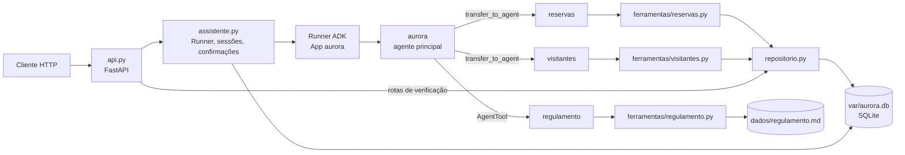

# 🚀 Desafio MBA Engenharia de Software com IA - Full Cycle


# Residencial Aurora: assistente virtual com Google ADK

Este é o assistente do aplicativo dos moradores do Residencial Aurora. Pelo chat, o morador reserva e cancela áreas comuns, autoriza visitantes e tira dúvidas sobre o regulamento. Ele é exposto por uma API FastAPI em `http://localhost:8000`.

> **O modelo decide o caminho, o código decide o que é permitido.** Todas as regras críticas vivem nas tools, no banco e na API. Nenhuma depende do que está escrito no prompt.

Stack: Python 3.12 + uv, `google-adk==2.2.0`, Gemini (`gemini-2.5-flash`) via Google AI Studio, FastAPI + Pydantic e SQLite (`aiosqlite`).

---

## Arquitetura



### Agentes

| Agente | Responsabilidade | Como é acionado | Por quê |
|---|---|---|---|
| `aurora` (principal) | Recebe o morador, identifica o assunto e distribui o trabalho. Não tem tools de dados nem o regulamento nas instruções. | Agente raiz do `App`. | Um ponto de entrada só. Ele não tem tool que grave dados, então mesmo que seja manipulado não consegue gravar nada. |
| `reservas` | Lista, cria e cancela reservas do apartamento da sessão e consulta a disponibilidade. | `sub_agent` do principal, via `transfer_to_agent`. | A reserva com taxa pede confirmação, e a resposta precisa voltar a **este** agente. Como `sub_agent` transferível, ele é o autor do pedido de confirmação, e o Runner retoma nele (ver Garantia 1). Ele continua ativo nas mensagens seguintes sobre reservas, sem custo extra de roteamento. |
| `visitantes` | Lista e autoriza visitantes do apartamento da sessão. | `sub_agent` do principal, via `transfer_to_agent`. | Pelo mesmo motivo de `reservas`: autorizar visitante sempre pede confirmação. |
| `regulamento` | Responde dúvidas lendo **um capítulo** de `dados/regulamento.md`. | `AgentTool` do principal. | O `AgentTool` roda o especialista num Runner próprio, com `InMemorySessionService`. O capítulo lido fica nesse contexto isolado, e só a resposta final entra nos eventos da sessão persistida (Garantia 4). Ele não precisa de confirmação nem de conversar com o morador. |

As definições estão em [`src/aurora/agentes.py`](src/aurora/agentes.py). O modelo é um único `Gemini` compartilhado, com `retry_options` (espera exponencial no `429`).

### Camadas

| Arquivo | Papel |
|---|---|
| [`src/aurora/api.py`](src/aurora/api.py), [`esquemas.py`](src/aurora/esquemas.py) | Rotas do contrato, modelos Pydantic e mapeamento de erros (`404`, `409`, `503`). |
| [`src/aurora/assistente.py`](src/aurora/assistente.py) | Cria sessões, executa o `Runner`, monta `confirmacoes_pendentes` a partir dos eventos e transforma a resposta do morador no `FunctionResponse` que o ADK espera. |
| [`src/aurora/ferramentas/`](src/aurora/ferramentas) | Tools dos especialistas. São a única porta do modelo para os dados. |
| [`src/aurora/repositorio.py`](src/aurora/repositorio.py) | SQL de reservas, visitantes e sessões, sempre filtrado pelo apartamento de quem chama. |
| [`src/aurora/banco.py`](src/aurora/banco.py) | Schema, conexão, carga inicial (`restaurar`) e inicialização sem perda (`inicializar`). |

### Persistência

Um único arquivo SQLite (`var/aurora.db`) guarda:
- as tabelas do `DatabaseSessionService` do ADK (sessões e eventos);
- as tabelas de domínio: `apartamentos`, `areas`, `reservas`, `visitantes`, `sessoes` e `sequencias`.

Os arquivos de `dados/` só são lidos, como estado inicial. O banco usa WAL, `busy_timeout` e `BEGIN IMMEDIATE` nas escritas.

### Fluxo de uma confirmação

1. O morador pede o salão. O `reservas` chama `reservar_area`. O callable `_reserva_gera_cobranca` vê que a taxa é maior que zero, a tool não grava nada e o ADK emite um `FunctionCall adk_request_confirmation`, gravado na sessão com o autor `reservas`.
2. A API devolve esse pedido em `confirmacoes_pendentes`, com `id`, `acao` e `detalhes` (`area`, `data`).
3. `POST /sessoes/{id}/confirmacoes` confere se o `id` está pendente nesta sessão. Se estiver, envia ao Runner um `FunctionResponse(name="adk_request_confirmation", response={"confirmed": ...})`.
4. O Runner escolhe o autor do último evento, que é o `reservas`. O processador de confirmação do ADK reexecuta `reservar_area` com `tool_context.tool_confirmation`, e a reserva é gravada uma única vez.

---

## Garantias

### 1. Cobrança ou acesso só com confirmação

**Onde:**
- [`ferramentas/reservas.py`](src/aurora/ferramentas/reservas.py):
  - `FunctionTool(reservar_area, require_confirmation=_reserva_gera_cobranca)`;
  - o callable `_reserva_gera_cobranca` devolve `True` quando a área existe, tem `taxa > 0` e a data está livre;
  - dentro de `reservar_area`, o guarda `if area_reservada.gera_cobranca and not aprovado_pelo_morador(tool_context): ... return erro(...)`.
- [`ferramentas/visitantes.py`](src/aurora/ferramentas/visitantes.py):
  - `FunctionTool(autorizar_visitante, require_confirmation=_visitante_exige_confirmacao)`, que pede confirmação para todo pedido válido;
  - o guarda `if not aprovado_pelo_morador(tool_context): return erro(...)` antes de gravar.
- [`ferramentas/sessao.py`](src/aurora/ferramentas/sessao.py): `aprovado_pelo_morador` só é verdadeiro com `tool_context.tool_confirmation.confirmed`.
- [`assistente.py`](src/aurora/assistente.py):
  - `confirmacoes_pendentes(eventos)` lista os pedidos `adk_request_confirmation` sem `FunctionResponse` com o mesmo id;
  - `responder_confirmacao` faz `raise ConfirmacaoInexistente` (`409` em `api.py`) para qualquer id fora dessa lista;
  - `_conferir_retomada` registra um erro no log se a tool não for retomada após a resposta.

**Por que não depende do modelo:**
- Quem decide se a ação pede confirmação é uma função Python (`taxa > 0`, visitante), não o modelo.
- A aprovação só existe como `FunctionResponse` de autor `user`, e esse `FunctionResponse` é criado apenas pela rota de confirmações. O texto "já estou confirmando aqui" é só texto e não preenche `tool_confirmation`.
- Mesmo que a tool fosse chamada por outro caminho, o guarda interno recusa a gravação sem aprovação.
- O ADK reexecutaria a tool se a mesma resposta fosse reenviada. Por isso a API aceita só ids **pendentes**: depois de respondido, o id tem `FunctionResponse` gravado e passa a receber `409`.
- Uma trava por sessão (`self._travas`) serializa mensagens e confirmações da mesma sessão.
- Área sem taxa (quadra) e cancelamento não passam por `require_confirmation`.

### 2. Cada sessão pertence a um apartamento

**Onde:**
- [`assistente.py`](src/aurora/assistente.py): `criar_sessao` cria a sessão com `user_id=apartamento` e `state={CHAVE_APARTAMENTO: apartamento}` e registra `session_id → apartamento` na tabela `sessoes`. É o único lugar que define o apartamento.
- [`ferramentas/sessao.py`](src/aurora/ferramentas/sessao.py): `apartamento_da_sessao(tool_context)` lê o state e exige que ele bata com `tool_context.user_id`.
- [`ferramentas/reservas.py`](src/aurora/ferramentas/reservas.py) e [`ferramentas/visitantes.py`](src/aurora/ferramentas/visitantes.py):
  - **nenhuma tool tem parâmetro de apartamento**; os únicos argumentos são `area`, `data`, `codigo` e `nome`;
  - todas as tools que tocam dados de apartamento chamam `apartamento_da_sessao(tool_context)`.
- [`repositorio.py`](src/aurora/repositorio.py):
  - todo SQL de apartamento filtra `WHERE apartamento = ?`, inclusive `cancelar_reserva` e `cancelar_reserva_por_codigo`;
  - `area_disponivel` devolve só `bool`, e a mensagem de `DataOcupada` não cita código, apartamento nem morador.

**Por que não depende do modelo:**
- O modelo não tem como passar um apartamento, porque o schema das tools não tem esse campo.
- O valor vem do state, e esse state só é escrito na criação da sessão. Nenhuma tool o altera, e a API não envia `state_delta`.
- Por isso, "sou do 302" não muda nada. Cancelar a reserva de outro apartamento atualiza zero linhas, e a resposta é a mesma de "não existe".

### 3. Nada se perde no reinício

**Onde:**
- [`api.py`](src/aurora/api.py), `lifespan`:
  - `DatabaseSessionService(db_url=config.SESSOES_DB_URL)`, com `sqlite+aiosqlite` no mesmo `var/aurora.db`;
  - `banco.inicializar()`.
- [`banco.py`](src/aurora/banco.py): `inicializar` só cria o schema (`IF NOT EXISTS`) e semeia se a chave `meta.semeado_em` não existir. Apagar o banco é papel exclusivo de `restaurar`, que só roda pelo comando `aurora-restore`.
- [`assistente.py`](src/aurora/assistente.py): as confirmações pendentes são derivadas dos eventos persistidos, não de memória.

**Por que não depende do modelo:**
- Sessões, eventos, reservas, visitantes e o contador de códigos estão todos em disco. Subir a API nunca restaura nem limpa dados.
- O Runner retoma uma confirmação pendente a partir dos eventos gravados, então aprovar depois de reiniciar funciona. Isso foi testado com a sessão persistida.

### 4. O regulamento é consultado, não carregado

**Onde:**
- [`ferramentas/regulamento.py`](src/aurora/ferramentas/regulamento.py):
  - `capitulos()` recorta o arquivo nos títulos `## Capítulo`;
  - `indice()` expõe só os títulos;
  - `ler_capitulo(numero)` devolve um único capítulo.
- [`agentes.py`](src/aurora/agentes.py):
  - o índice de títulos fica só na instrução do `regulamento`;
  - o principal tem `tools=[AgentTool(regulamento_agente)]` e uma instrução sem nenhum trecho do regulamento.

**Por que não depende do modelo:**
- O principal não tem o texto nem como lê-lo diretamente.
- A tool devolve no máximo um capítulo por chamada.
- O especialista roda via `AgentTool` numa sessão em memória descartável. Os `function_response` com o texto do capítulo nunca chegam aos eventos persistidos, que guardam só a pergunta e a resposta final.

### 5. Dois moradores, uma reserva

**Onde:**
- [`banco.py`](src/aurora/banco.py): `CREATE UNIQUE INDEX ux_reservas_ativa_area_data ON reservas (area, data) WHERE status = 'ativa'`.
- [`repositorio.py`](src/aurora/repositorio.py), `criar_reserva`:
  - o INSERT roda numa transação `BEGIN IMMEDIATE`, junto com `UPDATE sequencias ... RETURNING valor`, que gera o código;
  - `except sqlite3.IntegrityError` → `raise DataOcupada`, que a tool devolve como resposta normal.

**Por que não depende do modelo:**
- Quem decide é o banco, no instante do INSERT. A conferência prévia (`area_disponivel`) só serve para dar uma mensagem melhor, não para garantir nada.
- Duas aprovações simultâneas chegam ao INSERT, uma vence e a outra recebe `DataOcupada`. A outra resposta sai com `200` e "data ocupada", sem erro de servidor.
- Cancelar marca `status = 'cancelada'` sem apagar a linha. Como `codigo` é `PRIMARY KEY` e vem de um contador transacional (`RSV-4822`, `RSV-4823`...), um código nunca se repete, nem o de uma reserva cancelada.

---

## Como rodar

### Pré-requisitos

- [uv](https://docs.astral.sh/uv/). Ele instala o Python 3.12 do projeto (`.python-version`).
- Uma chave do [Google AI Studio](https://aistudio.google.com/apikey).
  - O fluxo completo do avaliador faz cerca de 50 chamadas ao modelo.
  - O free tier do `gemini-2.5-flash` (20 requisições/dia, 5/minuto) não comporta isso; use um projeto com faturamento ativo.
  - Com a cota por minuto apertada, o modelo espera e tenta de novo. Se as tentativas se esgotarem, a API responde `503`.
- Nenhum serviço externo: o banco é um arquivo SQLite.

### Variáveis do `.env`

```bash
cp .env.example .env
```

| Variável | Obrigatória | Descrição |
|---|---|---|
| `GOOGLE_API_KEY` | sim | Chave do Google AI Studio. |
| `GOOGLE_GENAI_USE_VERTEXAI` | não | Vazio ou `FALSE` para usar o AI Studio. |
| `AURORA_MODEL` | não | Modelo Gemini de todos os agentes. Vazio usa `gemini-2.5-flash`. |
| `AURORA_DB_PATH` | não | Arquivo SQLite. Vazio usa `var/aurora.db`. |

### Comandos

```bash
uv sync                 # instala as dependências (google-adk==2.2.0 fixado)
uv run aurora-restore   # restaura os dados iniciais (com a API parada)
uv run aurora-api       # sobe a API em http://localhost:8000
```

- `aurora-restore` apaga o banco inteiro, **incluindo as sessões**, e recarrega reservas e visitantes de `dados/`.
- `aurora-api` pode ser parado com Ctrl+C e subido de novo. Sessões e dados continuam.
- A documentação interativa fica em `http://localhost:8000/docs`.

### Exemplo rápido

```bash
S=$(curl -s -X POST localhost:8000/sessoes -H 'Content-Type: application/json' \
      -d '{"apartamento": "101"}' | python3 -c 'import sys,json; print(json.load(sys.stdin)["session_id"])')

curl -s -X POST localhost:8000/sessoes/$S/mensagens -H 'Content-Type: application/json' \
     -d '{"texto": "Reserve o salão de festas para 2030-04-20."}'
# → {"resposta": "", "confirmacoes_pendentes": [{"id": "adk-...", "acao": "reservar_area",
#     "detalhes": {"area": "salao-de-festas", "data": "2030-04-20"}}]}

curl -s -X POST localhost:8000/sessoes/$S/confirmacoes -H 'Content-Type: application/json' \
     -d '{"id": "adk-...", "confirmado": true}'

curl -s localhost:8000/apartamentos/101/reservas
curl -s localhost:8000/sessoes/$S/eventos
```
